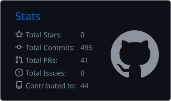
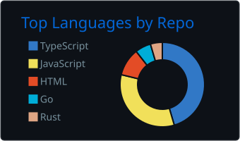

# Hi, I'm Amit Kumar Gupta 👋

### Backend Engineer · Distributed Systems · Fintech & Web3

I build backend systems that stay correct under load: event-driven pipelines, transactional money flows, and matching engines. B.Tech from NIT Calicut ('25), previously a Founding Backend Engineer.

**Open to full-time backend / distributed-systems roles.**

---

## 🏢 Experience

**Founding Backend Engineer, Milanam** (Remote) · Sep 2025 – Apr 2026
`Node.js` `NestJS` `TypeScript` `PostgreSQL` `Redis` `Prisma` `AWS` `Docker`

- Built production authentication with OAuth 2.0 / OIDC (PKCE, JWKS verification, refresh-token revocation) and Redis-backed rate limiting. Zero post-launch security incidents.
- Migrated MongoDB to PostgreSQL: 10+ relational entities, composite indexes, soft deletes, HMAC-encrypted PII. **45% lower query latency.**
- Designed a type-safe generic repository over Prisma, cutting cross-service boilerplate by **60%** across 5+ services.
- Set up private S3 storage (presigned uploads, least-privilege IAM) and GitHub Actions + Docker CI/CD, reducing manual deployment steps by **70%**.

**Software Engineer Intern, Tedekstra** (Remote) · Nov 2025 – Dec 2025
`NestJS` `TypeScript` `Next.js` `React Query` `Zustand`

- Delivered a full CRM in NestJS: WhatsApp Business / Meta API lead capture, bulk CSV ingestion, and role-based access across 4+ user tiers.
- Cut redundant network calls by **30%** with typed DTOs, interceptors and React Query caching; reduced frontend complexity by **40%** across 30+ modules.

---

## 🛠 Featured Projects

### ⚙️ [TriggerHub](https://github.com/Amitaarav/TriggerHub): Distributed Workflow Automation
`TypeScript` `Node.js` `Kafka` `PostgreSQL` `Next.js`

Event-driven automation platform built on the **Transactional Outbox pattern**: atomic Postgres writes plus `FOR UPDATE SKIP LOCKED` polling into Kafka. Zero event loss at 100K+ events/day with at-least-once delivery. Includes manual offset commits, exponential-backoff retries, a dead-letter queue, and a pluggable action registry (Email, Solana, Telegram, Discord, Slack).

### 💸 [MoneyTxn](https://github.com/Amitaarav/MoneyTxn): P2P Digital Wallet
`TypeScript` `Next.js` `Express` `PostgreSQL` `Prisma`

ACID-compliant P2P transfers using row-level locking, stress-tested at **5,000+ concurrent transactions with zero double-spends**. Features an HMAC-verified, idempotent bank webhook pipeline with replay protection, and an escrow-style off-ramp.

### 🦀 [CEX Backend (Rust)](https://github.com/Amitaarav/cex-rust): Exchange Matching Engine
`Rust` `Actix Web` `Tokio/mpsc`

Exchange backend with actor-style balance workers (no locks in balance logic) and a **price-time priority matching engine** on `BTreeMap` + `VecDeque`. Supports partial fills, cancellation, depth snapshots, and JWT auth. 14 tests. A learning project, documented openly, including its known limits.

### 🔗 [SolMit](https://github.com/Amitaarav/solmit): Solana Token Launchpad & Wallet Toolkit
`TypeScript` `React` `Solana Web3.js` `Metaplex`

Batches mint creation, ATA setup, minting and Metaplex metadata into a **single atomic transaction** with one wallet approval. Includes Jupiter swaps, Devnet/Mainnet switching, PDA/ATA derivation tooling, and Ed25519 signature verification.

---

## ⚡ Tech Stack

---

## 🏆 Highlights

- 🧠 500+ DSA problems solved on LeetCode and Codeforces
- 🏐 All-India NIT Volleyball champion (2024, 2025)
- 🎓 B.Tech, National Institute of Technology Calicut (2021–2025)

---

## 📊 GitHub Stats

  
  

---

## 📫 Let's connect

Open to full-time backend roles. Reach me at [amitgupta.nitc@gmail.com](mailto:amitgupta.nitc@gmail.com) or on [LinkedIn](https://linkedin.com/in/amitkrgupta8).
